<div align="center">

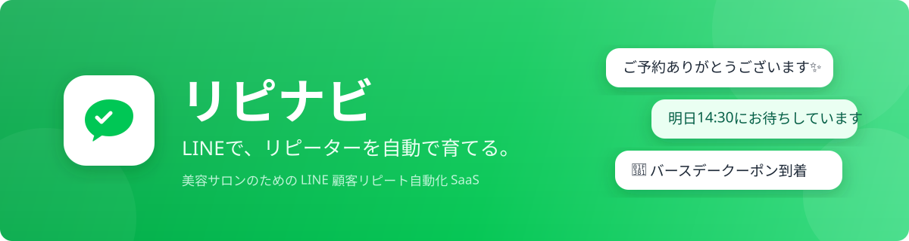

# リピナビ（Repinavi）

**LINEで、リピーターを自動で育てる。**

美容室・ネイルサロン・マツエクサロン・エステサロン向けの、<br>
LINE顧客リピート自動化マイクロSaaS。

<p>
  
  
  
  
  
  
  
</p>

</div>

---

## 課題と解決

サロンの売上はリピーターで決まります。しかし来店後のフォロー連絡は手作業になりがちで、
「忙しくて連絡できないまま、お客様が離れてしまう」ことが起こります。

**リピナビ**は、予約から次回来店までのコミュニケーションをLINEで自動化します。

```
   ご予約         前日        ご来店        2時間後        推奨間隔経過      お誕生日
     │            │            │             │                │              │
     ▼            ▼            ▼             ▼                ▼              ▼
  予約確認    リマインダー   （施術）   お礼＋アンケート   再来店のご案内   お祝い＋クーポン
     └──────────── すべてLINEで自動送信・手作業ゼロ ────────────┘
```

---

## スクリーンショット

### ダッシュボード
本日の予約・今月の来店・配信状況をひと目で確認できます。
初期設定が残っている間は、上部にセットアップガイドが表示されます。

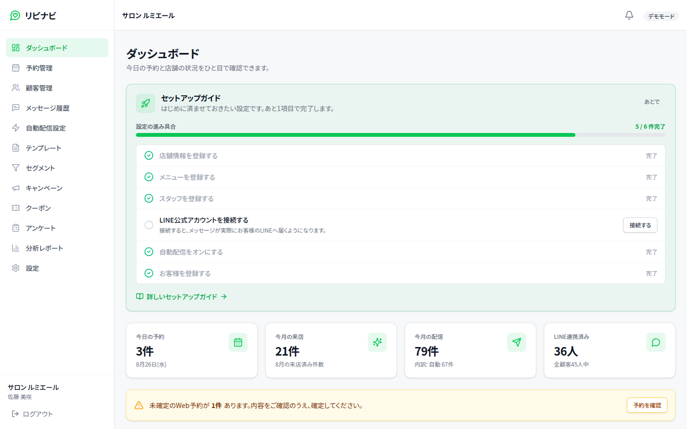

### 分析レポート
来店数の推移、リピート率、新規・リピーターの内訳、配信実績、クーポン利用、満足度を可視化します。

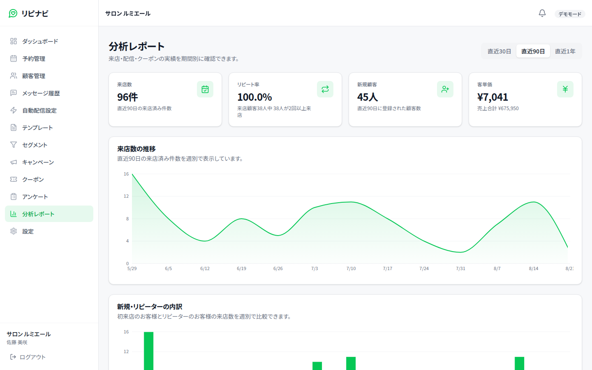

### 自動配信設定
7種類の自動配信を、オン・オフとタイミングだけで設定できます。

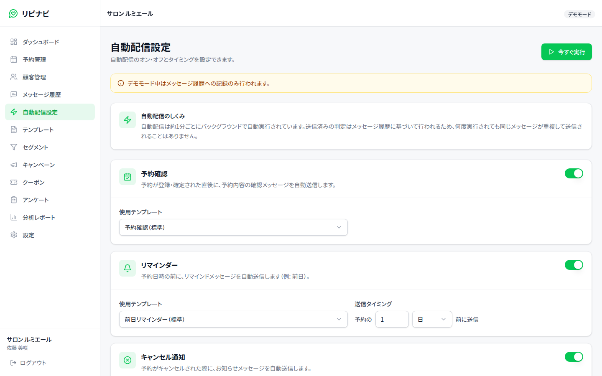

### 予約管理
日別・週間表示、ステータス管理、Web予約の確定までを1画面で。

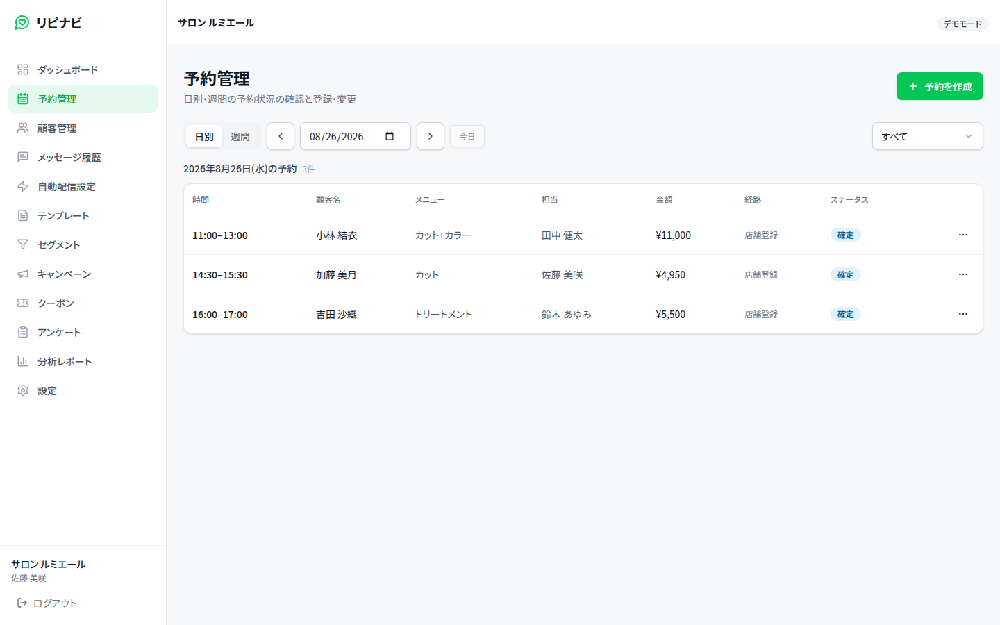

<table>
<tr>
<td width="50%" valign="top">

**顧客管理**

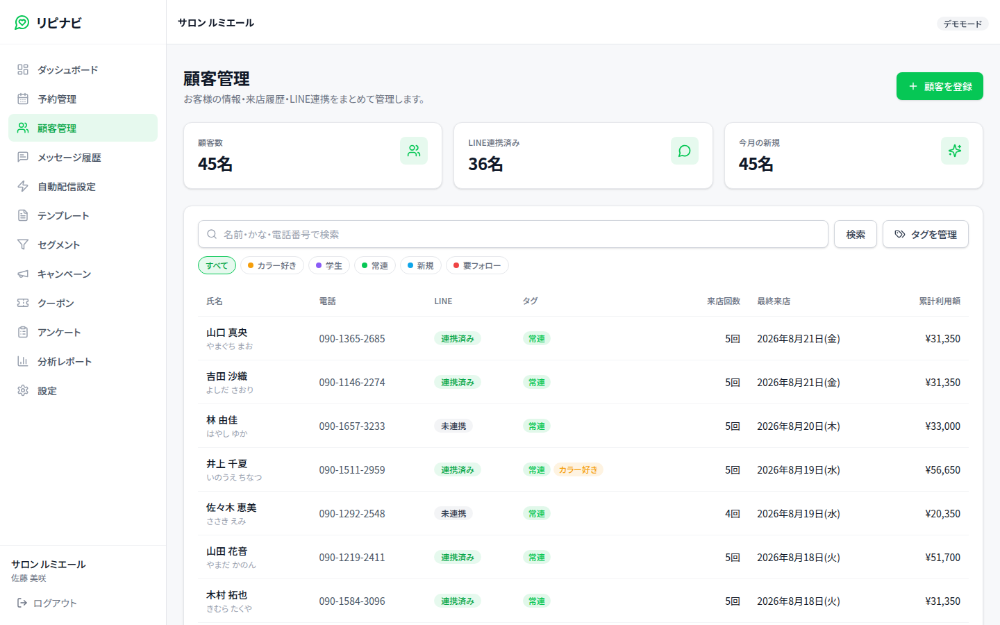

</td>
<td width="50%" valign="top">

**メッセージテンプレート**

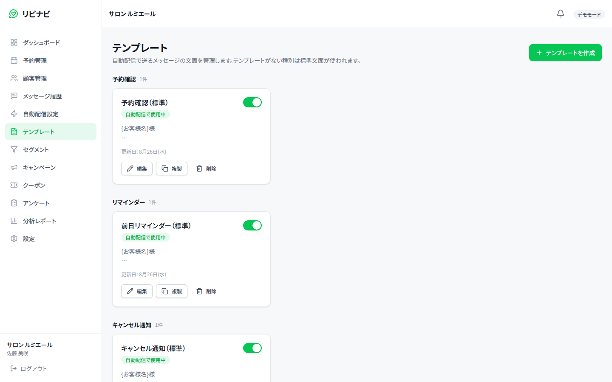

</td>
</tr>
<tr>
<td width="50%" valign="top">

**キャンペーン配信**

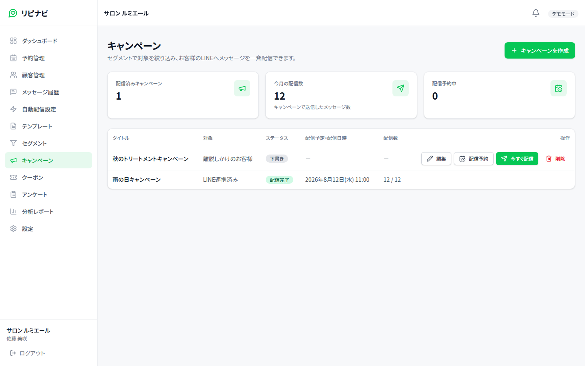

</td>
<td width="50%" valign="top">

**クーポン管理**

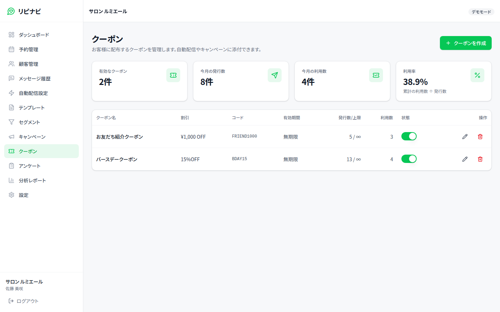

</td>
</tr>
<tr>
<td width="50%" valign="top">

**メッセージ履歴**

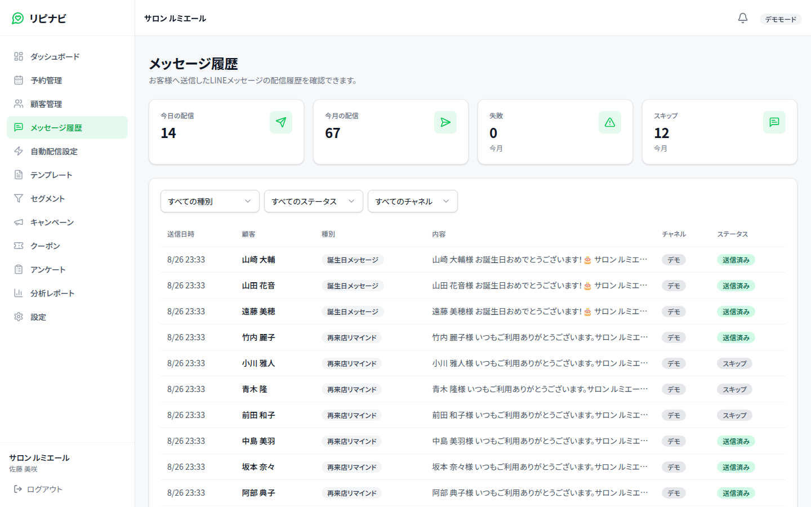

</td>
<td width="50%" valign="top">

**アンケート集計**

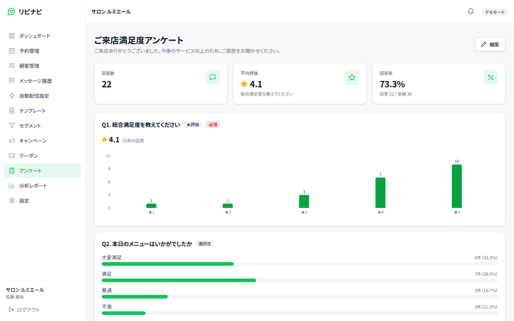

</td>
</tr>
<tr>
<td width="50%" valign="top">

**通知センター**

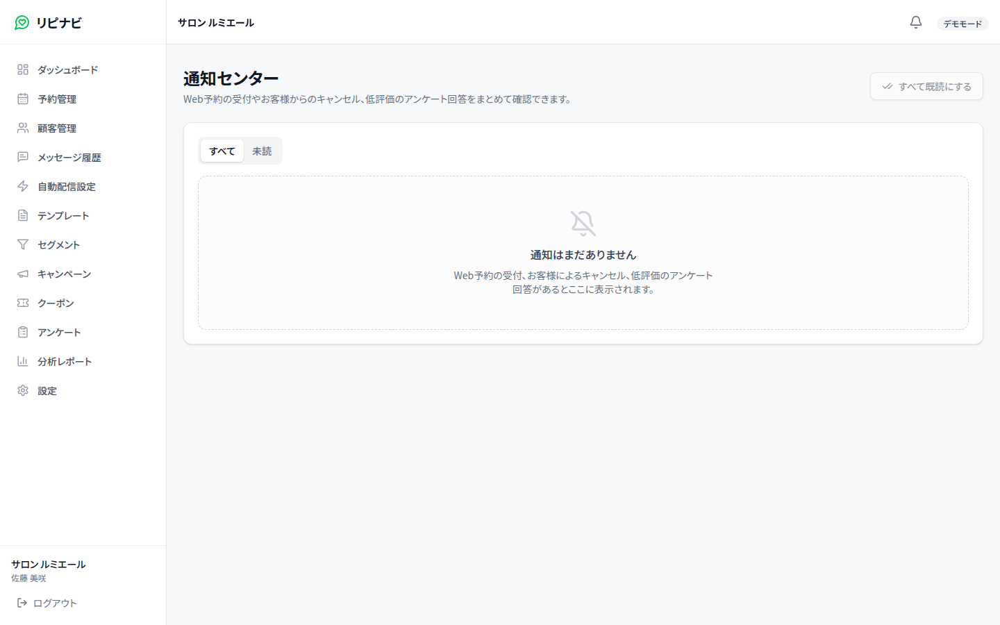

</td>
<td width="50%" valign="top">

**営業時間・臨時休業日**

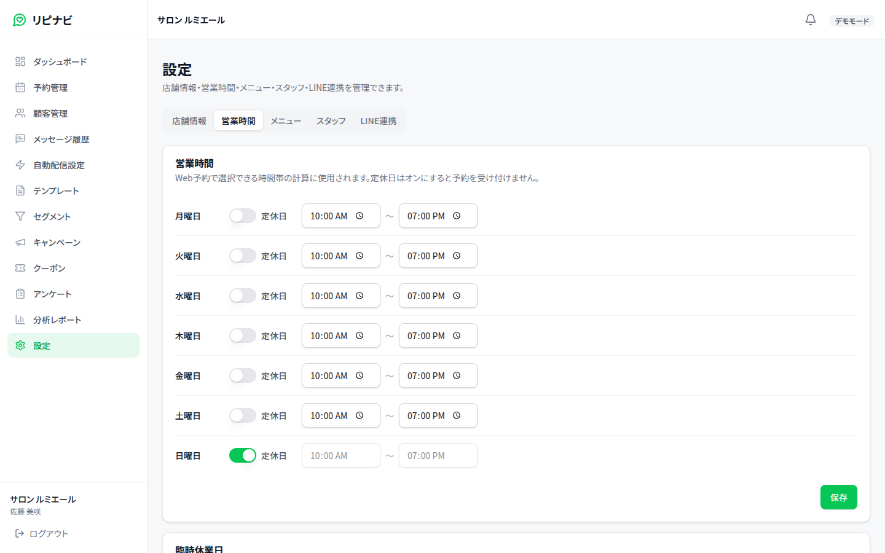

</td>
</tr>
</table>

### お客様向けページ（モバイル最適化）

公開ページはすべてスマートフォン前提の設計です。LINEのトークからそのまま開けます。

<table>
<tr>
<td width="25%" align="center">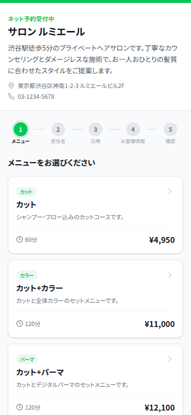<br><sub><b>Web予約</b><br><code>/r/[slug]</code></sub></td>
<td width="25%" align="center">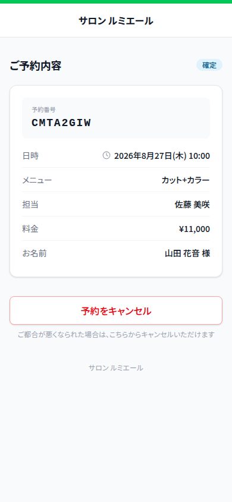<br><sub><b>予約確認・キャンセル</b><br><code>/v/[token]</code></sub></td>
<td width="25%" align="center">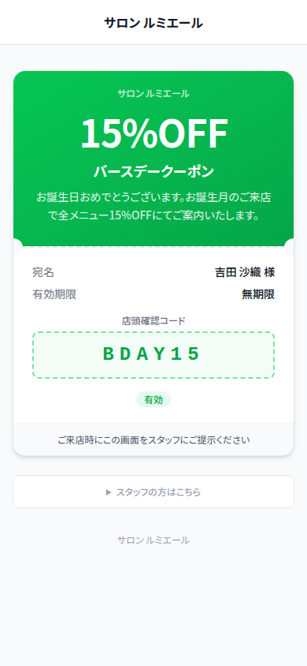<br><sub><b>デジタルクーポン</b><br><code>/c/[token]</code></sub></td>
<td width="25%" align="center">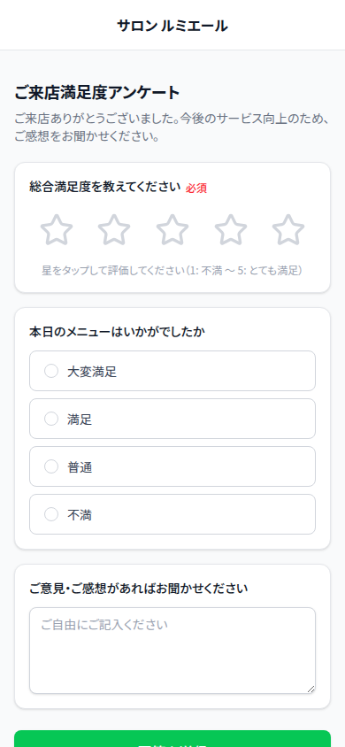<br><sub><b>満足度アンケート</b><br><code>/s/[token]</code></sub></td>
</tr>
</table>

### LINE連携設定

Channel Access Token を設定するまでは**デモモード**で動作し、LINE公式アカウントがなくても全機能を試せます。

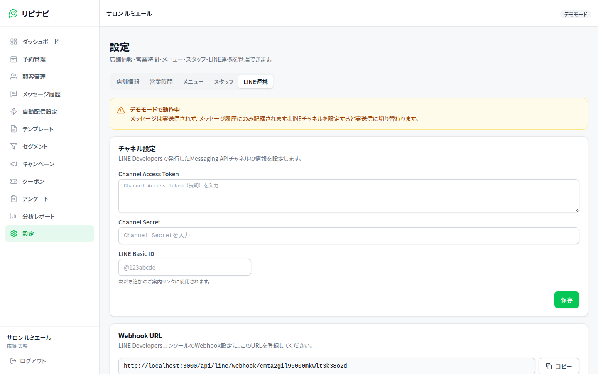

---

## 主な機能

### 自動配信（7種類）

| 種別 | タイミング | 内容 |
| --- | --- | --- |
| 予約確認 | 予約の登録・確定直後 | 日時・メニュー・担当を記載した確認メッセージ |
| リマインダー | 予約の N 日／N 時間前 | 前日リマインドで無断キャンセルを防止 |
| キャンセル通知 | キャンセル時 | キャンセル内容と再予約リンク |
| 日時変更通知 | 日時変更時 | 新しい予約内容のお知らせ |
| 来店お礼 | 来店完了の N 時間後 | お礼＋アンケート・クーポンを自動添付 |
| 再来店リマインド | メニュー別の推奨間隔経過後 | 次回来店のご案内（休眠化する前に接触） |
| 誕生日メッセージ | 誕生日当日の指定時刻 | お祝い＋バースデークーポン |

### 集客・分析

| 機能 | 説明 |
| --- | --- |
| 予約カレンダー | スタッフ列×時間軸のタイムグリッド（日／週表示）。空き枠クリックでそのまま新規予約 |
| Web予約ページ | 公開URLから24時間予約受付。メニュー→担当→日時→情報入力の5ステップ |
| 顧客セグメント | 最終来店日・来店回数・累計利用額・タグ・誕生月・性別・LINE連携で抽出 |
| キャンペーン配信 | セグメント宛に一斉配信（即時／日時指定）。クーポン同梱可 |
| デジタルクーポン | 発行・配布・店頭消込までを管理。％割引／金額割引に対応 |
| 満足度アンケート | 星評価・選択式・自由記述を組み合わせて作成し、回答を自動集計 |
| 分析レポート | 来店数推移・リピート率・客単価・配信実績・クーポン利用・満足度 |
| 施術カルテ | 施術内容・使用薬剤・次回への申し送りを顧客ごとに記録 |
| 通知センター | Web予約・キャンセル・低評価・配信完了・自動配信の失敗を通知 |
| 顧客CSV入出力 | 既存の顧客台帳を取り込み、絞り込んだ状態のまま書き出しも可能 |
| 臨時休業日 | 設備メンテナンス等の休業日を登録し、Web予約の受付から除外 |
| セットアップガイド | 初期設定の進捗を可視化し、未設定の項目へ誘導 |
| 予約QRコード | Web予約ページのQRを店頭掲示用に印刷 |

### 顧客体験

- **LINE連携**：6桁のコードをトークに送るだけで会員情報と紐づけ（Webhook経由）
- **予約の自己管理**：お客様自身が予約確認・キャンセルを行える
- **モバイルファースト**：公開ページはすべてスマホ最適化

---

## 技術スタック

| 領域 | 採用技術 |
| --- | --- |
| フレームワーク | Next.js 15（App Router / Server Components）、React 19 |
| 言語 | TypeScript（strict） |
| スタイル | Tailwind CSS v4（`@theme` トークン）、Radix UI |
| データベース | PostgreSQL 16（Docker）、Prisma 6 |
| メッセージング | LINE Messaging API（`@line/bot-sdk`） |
| 認証 | jose（JWT・HttpOnly Cookie）＋ bcryptjs |
| バリデーション | zod（全APIの入力を検証） |
| チャート | Recharts |
| テスト | Vitest（98件） |

---

## セットアップ

### 必要環境

- Node.js 20 以上
- Docker（PostgreSQL用）

### 手順

```bash
# 1. 依存をインストール
npm install

# 2. 環境変数を用意
cp .env.example .env

# 3. PostgreSQL を起動
npm run db:up

# 4. スキーマを反映（マイグレーション適用）
npm run db:deploy

# 5. デモデータを投入
npm run db:seed

# 6. 開発サーバーを起動
npm run dev
```

http://localhost:3000 を開き、デモアカウントでログインしてください。

> **デモアカウント** — `demo@repinavi.jp` / `demo1234`
>
> 顧客45名・予約215件・配信履歴・アンケート回答・クーポン発行を含む
> リアルなデモデータが投入され、すべての画面をそのまま体験できます。

### 環境変数

| 変数 | 説明 |
| --- | --- |
| `DATABASE_URL` | PostgreSQL 接続文字列 |
| `SESSION_SECRET` | セッションJWTの署名鍵（本番では必ず変更） |
| `CRON_SECRET` | 自動配信cronエンドポイントの認証トークン |
| `APP_URL` | 公開URL。予約・クーポン・アンケートのリンク生成に使用 |
| `AUTOMATION_INTERVAL_MS` | 開発用アプリ内スケジューラの実行間隔（既定 60000。本番では未設定推奨） |

---

## デモモードについて

店舗のLINEチャネル（Channel Access Token）が未設定の間は**デモモード**で動作します。
メッセージは実送信されず、すべて「メッセージ履歴」に `DEMO` として記録されるため、
**LINE公式アカウントを用意しなくても全機能を検証できます。**

実際にLINE送信を行うには、ダッシュボードの **設定 → LINE連携** で以下を設定してください。

1. [LINE Developers](https://developers.line.biz/) で Messaging API チャネルを作成
2. Channel Access Token（長期）と Channel Secret を取得して保存
3. 設定画面に表示される Webhook URL をチャネルに登録し、Webhookを有効化
4. LINE公式アカウントの応答メッセージ（自動応答）をオフ

---

## 自動配信エンジン

自動配信は `src/lib/automation/` の配信エンジンが担います。
**送信済み判定はメッセージログに基づくため、何度実行しても重複送信されません（冪等）。**

```
                    ┌─────────────────────────────┐
  cron / scheduler  │      runAutomations()       │
        ──────────▶ │  店舗ごとに順次実行          │
                    └──────────────┬──────────────┘
                                   │
     ┌───────────┬─────────────┬───┴───────┬─────────────┬──────────────┐
     ▼           ▼             ▼           ▼             ▼              ▼
 リマインダー  来店お礼   再来店リマインド  誕生日    キャンペーン配信
     └───────────┴─────────────┴───────────┴─────────────┘
                                   │
                                   ▼
                    sendAutomationMessage()  ── 設定OFFなら送信しない
                                   │           クーポン/アンケートを発行しリンク差込
                                   ▼
                        deliverMessage()  ── LINE未連携なら SKIPPED
                                   │          チャネル未設定なら DEMO
                                   ▼
                          MessageLog に記録（重複送信の判定材料）
```

- **開発環境**：`.env` の `AUTOMATION_INTERVAL_MS` でアプリ内スケジューラが定期実行
- **本番環境**：外部cronから毎分程度で以下を呼び出してください

```bash
curl "https://<APP_URL>/api/cron/run?secret=<CRON_SECRET>"
```

---

## アーキテクチャ

### マルチテナント設計

1つのアプリで複数店舗を運用します。**すべてのクエリが `storeId` でスコープされ**、
更新・削除は所有チェック（`findFirst({ where: { id, storeId } })`）を必ず通ります。

```
Store（店舗＝テナント）
 ├─ User            ログインユーザー（OWNER / STAFF）
 ├─ Service         メニュー（所要時間・料金・推奨再来店間隔）
 ├─ StaffMember     施術スタッフ
 ├─ Customer        顧客（LINE連携・来店統計・タグ）
 ├─ Reservation     予約（PENDING→CONFIRMED→COMPLETED）
 ├─ MessageTemplate 文面テンプレート（プレースホルダー対応）
 ├─ AutomationSetting 自動配信設定（種別ごとに1件）
 ├─ MessageLog      配信ログ（冪等性の判定材料）
 ├─ Coupon / CouponIssue    クーポンと発行・消込
 ├─ Survey / SurveyResponse アンケートと回答
 ├─ Segment / Campaign      抽出条件と一斉配信
 ├─ TreatmentRecord         施術カルテ
 ├─ StoreHoliday            臨時休業日
 └─ Notification            通知センター
```

### ディレクトリ構成

```
src/
├── app/
│   ├── dashboard/          # 管理画面（要ログイン・middlewareで保護）
│   │   ├── reservations/   # 予約管理
│   │   ├── customers/      # 顧客管理・施術カルテ
│   │   ├── automations/    # 自動配信設定
│   │   ├── campaigns/      # キャンペーン
│   │   ├── analytics/      # 分析レポート
│   │   └── settings/       # 店舗・営業時間・メニュー・スタッフ・LINE
│   ├── r/[slug]/           # 公開Web予約ページ
│   ├── v/[token]/          # 予約確認・キャンセル
│   ├── s/[token]/          # アンケート回答
│   ├── c/[token]/          # クーポン表示・店頭消込
│   └── api/                # APIルート（LINE Webhook・cron含む）
├── lib/
│   ├── automation/         # 自動配信エンジン（冪等）
│   ├── line/               # LINE Messaging API クライアント
│   ├── messaging.ts        # 配信オーケストレーション
│   ├── segments.ts         # セグメント抽出
│   ├── slots.ts            # 予約枠計算
│   ├── availability.ts     # 重複予約の判定
│   ├── templates.ts        # プレースホルダー描画
│   └── jst.ts              # 日本時間ユーティリティ
└── components/
    ├── ui/                 # UIキット（Radix ベース）
    └── shell/              # サイドバー・モバイルナビ・通知ベル
```

### 設計上の要点

- **日時はUTC保存・JST判断**：日付境界の判断は必ず `@/lib/jst` を経由し、`toLocaleString` は使いません
- **予約枠計算**：営業時間・臨時休業日・所要時間・スタッフ指名・キャパシティを考慮（`src/lib/slots.ts`）
- **二重予約の防止**：公開予約ページはサーバー側で空き枠を再検証し、管理画面からの登録・変更も重複を検出（`src/lib/availability.ts`）
- **競合状態の考慮**：キャンペーンの配信・中止・編集はステータス条件付き更新でクレームし、二重配信や配信中の上書きを防止
- **配信の冪等性**：送信済み判定はメッセージログに基づくため、再実行しても同じお客様に重複送信しません

---

## コマンド

```bash
npm run dev        # 開発サーバー
npm run build      # 本番ビルド
npm run start      # 本番サーバー
npm run typecheck  # 型チェック
npm run test       # ユニットテスト（vitest）
npm run db:up      # PostgreSQL を起動
npm run db:deploy    # スキーマ反映
npm run db:seed    # デモデータ投入
npm run db:studio  # Prisma Studio
```

## テスト

日時計算・予約枠計算・テンプレート描画・セグメント条件など、
**バグが顧客への誤送信に直結する純粋関数**を中心に98件のユニットテストを用意しています。

```bash
npm run test
```

| テスト | 対象 |
| --- | --- |
| `tests/jst.test.ts` | JST変換・日付境界・経過日数・誕生日判定 |
| `tests/slots.test.ts` | 予約枠計算（定休日・臨時休業日・指名・キャパシティ・リードタイム） |
| `tests/templates.test.ts` | プレースホルダー描画と変数構築 |
| `tests/segments.test.ts` | セグメント条件の検証と日本語説明文 |
| `tests/utils.test.ts` | 金額・数値・パーセント書式、コード生成 |

---

## ドキュメント

| ドキュメント | 内容 |
| --- | --- |
| [docs/DEPLOY.md](docs/DEPLOY.md) | 本番デプロイ手順（環境変数・cron・LINE Webhook・nginx・バックアップ） |
| [docs/OPERATIONS.md](docs/OPERATIONS.md) | 運用ガイド（自動配信が届かないときの確認手順・障害対応・定期メンテナンス） |
| [docs/CONTRACT.md](docs/CONTRACT.md) | 実装規約（アーキテクチャ・命名・テナント分離の方針） |

## ライセンス / 著作権

© 2026 [info.aoi-webstudio.com](https://info.aoi-webstudio.com) — All rights reserved.

本ソフトウェアおよび関連ドキュメントの著作権は info.aoi-webstudio.com に帰属します。

<div align="center">
<sub>Built with ❤️ for salons by <a href="https://info.aoi-webstudio.com">info.aoi-webstudio.com</a></sub>
</div>
